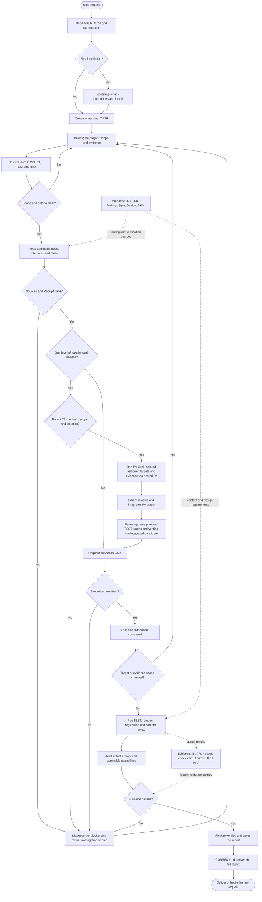

<!-- APCF-META {"schema":1,"visibility":"public"} -->
<div align="center">
<h1>Agent Project Control Framework (APCF)</h1>
<p>Project rules, scoped execution, evidence-based checks, and reviewable handoff for Codex</p>
<p>Core candidate v0.3.2 · Framework schema v0.3.0 · Writing, Style, and Design rules v0.1</p>
<p><a href="README.md">简体中文</a></p>
<p><a href="README.md#workflow-map">Workflow diagram</a></p>
</div>

## 1 Purpose and workflow

APCF gives long-running Codex work a reviewable path: establish the rules and scope, investigate and plan, execute and verify, return to investigation when a repair is needed, and update `CURRENT.md` from the finalized report

The diagram below has the same nodes and edges as the Chinese version; neither diagram is a substitute for the canonical rules

<a id="workflow-map"></a>

<div align="center">



<p align="center"><em>Figure 1.1-1: scoped work, verification and recovery</em></p>

</div>

When parallel work helps, the parent TR first establishes the current rule sources, task and write scope, resource isolation, and recovery conditions. It may create one level of PA records only. Each PA works only on its isolated assigned objects and records its own outputs and evidence; it cannot create child PAs. The main agent checks and integrates the returned work, updates the parent plan and TEST, then reroutes and verifies the integrated candidate. A Receipt confirms that applicable sources were loaded; it does not grant external-action authorization

On first installation, `bootstrap.py` checks the target before adding the control shell to a new directory or an existing project without conflicting markers. It does not bring development iterations, user materials, or runtime records into the target. The agent then creates or reuses an iteration and a turn, loads the rules, interfaces, and Skills triggered by the current task, and records the plan

The action Gate checks current routing, plan, and evidence before it runs one command once. Afterward, `routing_activity.py check` records the actual command, exit code, output, and candidate fingerprint. Content review records observations, locations, evidence, and the current ruleset hashes. Audit checks whether the plan covers the observed work; the full Gate checks the current candidate and evidence. A failed Gate returns the agent to investigation and repair. The Gate does not invent a repair or retry indefinitely

## 2 Project fit and limits

This template is intended for code projects that need Codex to maintain work across multiple turns. It connects user requests, project rules, actual changes, tests, and delivery records

- It adds a control shell while leaving the project’s source, tests, configuration, and native toolchain in place
- It keeps framework rules, project facts, current turn records, and temporary agent output in separate locations
- It supports acceptance with real commands, current file hashes, and reviewable evidence
- It leaves external accounts, remote repositories, deployments, and publication actions under user authorization

APCF does not replace native project tests, professional judgment, user authorization, or production acceptance. It does not invent project goals, architecture, or design adoption facts

## 3 Files and sources of truth

Each fact has one maintained home. This README introduces the entry points; it does not duplicate the rule texts

- `AGENTS.md` is the agent entry point for initialization, rule routing, and finalization
- `.agent-project-control/framework.yaml` declares framework schema version `v0.3.0`
- `.agent-project-control/rules/INDEX.md` routes R01–R31; the rule texts live in `.agent-project-control/rules/`
- `.agent-project-control/PROJECT.md` stores project goals, users, and scope
- `.agent-project-control/ARCHITECTURE.md` stores system boundaries, dependencies, data, and runtime facts
- `.agent-project-control/DESIGN.md` stores project design adoption, sources, and differences
- `.agent-project-control/interfaces/` routes Writing `v0.1` and Style `v0.1`; their version lock is `.agent-project-control/standards/LOCK.yaml`
- `.agent-project-control/design/` stores shared D01–D16 rules `v0.1`, version locks, and optional Profiles
- `.agent-project-control/skills/SKILLS.lock.yaml` records Skill sources, versions, and required status
- `CURRENT.md` points to the current state and latest complete user report
- IT identifies a local unit with a stable objective; TR identifies an independent record for one request, checklist, tests, and evidence
- Each TR’s `CHECKLIST.md`, `TEST.md`, and `evidence/` record scope, acceptance conditions, and observations
- `.agent-project-control/regressions/`, `decisions/`, `runbooks/`, and `materials/` hold long-term regressions, decisions, operating guides, and user-provided materials
- `.agent-project-control/runtime/` is for temporary agent runs, caches, test copies, and distribution candidates
- `.agent-project-control/scripts/` contains routing, gates, synchronization, installation, and generation tools

For a new project, `PROJECT.md`, `ARCHITECTURE.md`, and `DESIGN.md` remain unknown or unadopted until the agent records actual project facts. The optional `tool-workbench-2.3.1` Profile is not adopted automatically

## 4 First run: two synthetic examples

The examples require Python 3.11 or newer and Git. They create isolated projects under `.agent-project-control/runtime/testbed/`, initialize a local Git repository, and save demo records. They do not push, change source-repository history, or adopt a Design Profile

Run both scenarios from the repository root with two different new paths:

```powershell
python -B examples/run_demo.py --project .agent-project-control/runtime/testbed/apcf-demo-success --scenario success
python -B examples/run_demo.py --project .agent-project-control/runtime/testbed/apcf-demo-repair --scenario repair
```

- `success` creates a small Python module, checks it with two real assertions, and runs Audit, the full Gate, Finalize, and a state-integrity check
- `repair` starts with a formatting failure in editable prose, confirms the Gate denies it without changing the candidate, repairs only the prose, verifies that protected code remains unchanged, and follows the same finalization path

Each target must be new or empty; the demo never removes existing content. Choose a new directory name to repeat a scenario. These fixed synthetic inputs demonstrate only the covered behavior and do not prove that a real business project has passed acceptance

## 5 Working on a real project

The agent uses the current `CURRENT.md` and the user request to decide whether to reuse the active IT or start a new stable objective. A normal task usually creates a new TR under the active IT

`routing_activity.py plan` binds actual investigation evidence, target files, and test IDs:

```powershell
python -B .agent-project-control/scripts/routing_activity.py plan --turn-dir PATH_TO_TR --target src/example.py --investigation evidence/investigation.md --regression-test TEST-001
```

The agent creates a current Receipt for the exact target path and reads the routed sources. A generic project-level Receipt does not replace current route coverage for the target:

```powershell
python -B .agent-project-control/scripts/route_context.py --phase scope --phase verification --phase tools --phase finalization --target src/example.py --turn-dir PATH_TO_TR
```

After routing, the agent inspects the target and existing evidence and records an object-specific semantic review with `record_semantic_review()`, using a concrete conclusion about the target and hashes of existing evidence. Users do not fill in an empty `--semantic-reviewed` marker

The action Gate runs one command only when current routing, plan, and evidence checks pass:

```powershell
python -B .agent-project-control/scripts/gate_enforce.py --entrypoint action --turn-dir PATH_TO_TR --target src/example.py --run python -B -m pytest
```

This example requires pytest and the project’s native dependencies in the project environment. `passed` is from pytest’s default summary; `routing_activity.py check` runs the command and records its exit code, required output, and current candidate hash. Choose a token present in the actual command output. Typing `PASS` into a document cannot replace this observation:

```powershell
python -B .agent-project-control/scripts/routing_activity.py check --turn-dir PATH_TO_TR --test-id TEST-001 --target src/example.py --expected-exit 0 --required-output passed --command python -B -m pytest
```

For content governed by Writing, Style, Design, or the README Skill, the agent also calls `record_content_review()` to record concrete observations, evidence hashes, and the active ruleset hashes. The full Gate requires current check records and content reviews. The synthetic examples provide the runnable reference for the longer first-use flow; each script’s `--help` is the source for all command options

## 6 Rules, Skills, and design adoption

- Human-readable content resolves Writing v0.1 through `WRITING_STANDARD.md` and applies Style v0.1 with it; canonical texts are stored in `.agent-project-control/standards/`
- README-specific rules come from the complete locked `AIALRA-0/github-readme-standardizer` Skill. Syncing the required Skill needs read access to its locked source and verifies the commit and file hash
- `github-safe-publish` is an optional local snapshot locked by file hash and is not included in a clean distribution. A missing cache is reported as `OPTIONAL_UNAVAILABLE`; explicitly routing to that missing capability still fails closed
- Design v0.1 contains the shared D01–D16 rules. `tool-workbench-2.3.1` is optional and has `auto_adopt: false`; project facts and an explicit adoption state are required before using its parameters as project rules
- The current README Skill places the diagram and caption in the same centered container. The Chinese and English diagrams use the same topology; their actual rendering requires separate validation

When a ruleset changes, its source hashes change too. An older Receipt does not replace reading and reviewing the new rules

## 7 Installation and clean distribution

To create a new project or add the control shell to an existing code directory without APCF markers, run this from the template repository root:

```powershell
python -B .agent-project-control/scripts/bootstrap.py ../my-project
```

Installation preserves existing source and configuration and adds `AGENTS.md`, `CURRENT.md`, `.agent-project-control/`, and empty `.codex` metadata directories. The target’s parent directory must already exist. If the target already has `AGENTS.md`, `CURRENT.md`, `.agent-project-control/`, or `.aialra/`, installation refuses before writing and does not remove or overwrite those objects. Choose a new directory or continue under the existing APCF installation

- **Core distribution**: the shared framework for adoption in another project. It keeps the general rules, shared design baseline, and Writing, Style, and Skill contracts, while excluding optional UI components under `design/components/*`. Think of it as the basic toolbox for project adoption, without an optional workbench

- **Add-on**: a separately installed optional capability. The Atlas workbench belongs in this category and is not a default Core dependency. Project design adoption still starts as `UNRESOLVED`. Think of it as a workbench accessory that a project can choose to add

To generate a Core candidate without optional components, source Git history, development IT/TR records, materials, runtime contents, or cached Skills:

```powershell
# Generate an independent Core candidate while retaining the source worktree and history
python -B .agent-project-control/scripts/prepare_distribution.py --profile core
```

The script prints the candidate directory. It retains the framework rules, interfaces, locks, scripts, public documents, and `examples/`, then regenerates the file tree. It does not create a ZIP, configure a remote, or publish. Optional `--manifest PATH` writes a private file-hash inventory outside the candidate; do not include that path or inventory in the public package

Both omitted `--profile` and explicit `core` now use the same explicit Core member registry. Optional components are distributed separately, never recursively copied into the default Core.

To adopt Core, first generate or extract the Core candidate, then run `bootstrap.py` from that Core directory. Installation copies explicit members and creates initial target-project facts, without inheriting source-project facts or optional UI components.

Check Skill caches with:

```powershell
python -B .agent-project-control/scripts/sync_skills.py --check
```

A missing optional cache does not fail this check; a missing required Skill or mismatched hash or commit still fails. Syncing the required README Skill needs network access and permission to read its source. The distribution includes neither `.git` nor `.codex/skills` caches

**Before a candidate publication check:** From the source repository root, set these variables to actual object paths, replacing any example values before running the command

- `$turn`: the current real source TR
- `$candidate`: an independent local Git repository containing the release candidate
- `$manifest`: the private path, byte-count, and SHA-256 inventory outside the candidate repository
- `$zip`: the actual release archive

Supply all three candidate arguments together. The check requires the source TR's publish Full Gate and state validation, then compares the independent Git index and actual ZIP members against the manifest

Gitleaks must be available on `PATH`; if it is missing or cannot complete the scan, the check fails closed

Explicitly route to `github-publish` only after installing the optional `github-safe-publish` Skill from its locked source. A clean distribution excludes that Skill cache, so a missing installation remains fail closed

```powershell
python -B .agent-project-control/scripts/publish_guard.py --turn-dir "$turn" --candidate-repo "$candidate" --manifest "$manifest" --candidate-zip "$zip"
```

This command checks the supplied objects only. It does not grant external-action authorization, commit, or push, and it cannot prevent someone from bypassing it with a direct `git push`

## 8 Verification and repair

Gate results apply to the current candidate and its evidence. Tests, regressions, semantic reviews, and content reviews cover different concerns and do not replace one another

- `REPAIR_REQUIRED` means there are actionable findings. The agent reads `REPAIR_SET`, identifies the cause, and plans a repair that can be checked
- `CHANGED` describes a change in the failure set between attempts; it does not mean the candidate passed. The agent checks new and remaining findings before proceeding
- `STALLED` means the candidate or failure set made no progress; `CYCLE` means an earlier failure set returned during the current repair episode. Both result in `NO_PROGRESS`, so the agent should not repeat the same action
- `BLOCKED` means a finding cannot be safely resolved with the current evidence or capability. The agent explains the missing evidence, capability, or user decision before choosing what can continue

Each failure remains in the Gate record and returns to investigation and planning. The system does not retry forever, and a manually entered `PASS` does not bypass the Gate. A human review must identify the object and observation; passing a machine check does not prove every semantic requirement is satisfied

## 9 Redaction and runtime data

Distribution uses visibility metadata, object lifecycle, and the source of each fact. A `public` label allows an object into the candidate but does not prove it contains no secret. The candidate also needs checks for personal absolute paths, accounts, email addresses, credentials, and credential-bearing connection strings

- Keep canonical rules, standards, version hashes, project-relative paths, and clearly labeled synthetic examples
- Exclude source `.git` history, development IT/TR/MAT records, runtime evidence, caches, and machine-specific state
- Do not rewrite source history to make a clean candidate; source file hashes remain unchanged by candidate generation
- Keep uncertain identity or credential findings under review instead of treating a missed pattern as proof of safety

Development evidence and machine-specific paths belong in private turn records, not in public template reports

## 10 Entry points and known limits

- [Codex execution prompt](CODEX_PROMPT.md): starting context for Codex after project setup
- [Deployment contract](CODEX_DEPLOY.md): project creation, existing-project installation, and remote permissions
- [Template specification](TEMPLATE_SPEC.md): responsibilities of public content, the control shell, and project facts
- [Pilot test plan](PILOT_TEST_PLAN.md): installation and acceptance in a fresh copy
- [Validation notes](VALIDATION.md): template capabilities, tested scope, and unverified environments
- [Framework entry point](AGENTS.md): rule routing, task initialization, and finalization

Framework Gate scripts use `tomllib` and require Python 3.11 or newer. Other operating systems and final GitHub page rendering need review in their actual target environment

## 11 Previous maintenance version core-repair-r1

Use [APCF-START.md](APCF-START.md) for onboarding and later-request recovery; the [onboarding interface](.agent-project-control/interfaces/APCF_ONBOARDING.md) coordinates the actual sequence. New acceptance records use natural prose with bound source ranges, visible terminology evidence, and coverage of material conclusions.

Request identity and guarded writes constrain calls made through these entrypoints, not every external tool or chat channel. Preparing approved text and comparing captured text are distinct; neither authenticates user receipt. The schema remains 0.3.0, historical records remain compatible, and Writing/Style/shared Design originals remain protected.

## 12 Stage release and lightweight supervision

The Core candidate is `v0.3.2`; the framework data schema remains compatible with `0.3.0`. Release assets are built from the current final source; deployment leaves local optional-component registration, valid repairs, and source history intact. The Core package excludes source history. Record Core and external Codex versions separately.

`scripts/supervisor.py` checks CURRENT and its actual source, emits phase-specific rules, checks the pre-write plan, and reuses existing verification and finalization. See the [supervision interface](.agent-project-control/interfaces/EXECUTION_SUPERVISION.md) and [onboarding entry](APCF-START.md).

Its receipt records observations, not certified understanding or independent review. Guarded file writes do not intercept every shell. Desktop auto-triggering and actual final-output transport require real host evidence, not function tests.

The locked `tool-workbench-2.3.1` remains a historical Profile, not the latest Atlas. The public release separately exposes `examples/design-atlas/index.html`; the minimal Core does not include the demo or automatically restyle an existing application.

Full Pilot belongs to release and significant Core validation. Ordinary work uses the checks applicable under the canonical rules rather than repeating all framework selfchecks. Record real overhead and untested host boundaries.

## 13 Writing revision

Preparation before drafting and before reviewing emits short rules and minimal examples; existing interfaces still load the full authoritative standards. The derived index contains 29 Writing, 15 Style, and 16 Design reminders, without becoming another authority.

New turns bind `writing-reliability-1` automatically. An ongoing maintenance turn must actually reread changed standards, refresh its existing session, and bind explicitly; frozen historical records keep their bytes. See the [writing interface](.agent-project-control/interfaces/WRITING_STANDARD.md) for calls.

Each report glossary term is a separate first-level list item with its verified name, meaning, current relevance, and accurate analogy. Checks reject known nesting, merged terms, hidden explanations, naming errors, missing reads, and candidate drift. Semantic sufficiency still requires review of actual text; structural success cannot certify it.

Source `TEST.md` and `TURN.md` retain machine location comments. After the original gates approve a report, the output entry removes recognized standalone comments while preserving visible facts, order, and evidence. Source and visible output have separate hashes; literal content in code and quotations remains unchanged.
