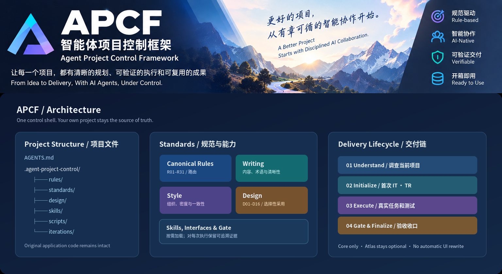
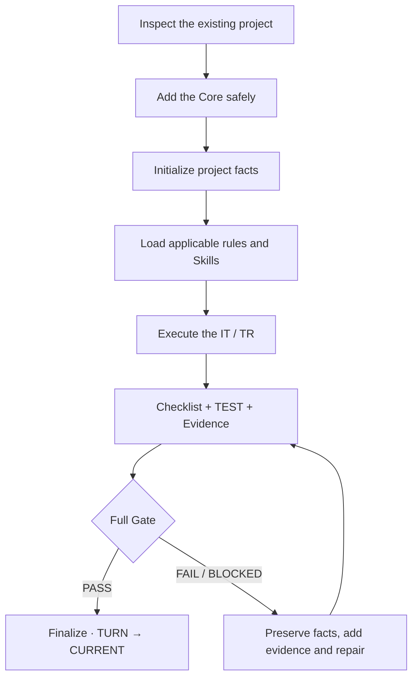

<!-- APCF-META {"schema":1,"visibility":"public"} -->
<div align="center">



Figure 1. APCF identity, operating principles and system overview

<h1>APCF · Agent Project Control Framework</h1>

<p><strong>A reusable control layer for AI agents working inside real projects: rules, evidence, repeatable execution and verifiable delivery</strong></p>

[简体中文](README.md) · [Quick Start (Chinese)](docs/QUICKSTART.md) · [Architecture (Chinese)](docs/ARCHITECTURE.md) · [One-shot Onboarding (Chinese)](APCF-START.md) · [Latest Release](https://github.com/AIALRA-0/APCF/releases/latest)

**Core v0.3.0** · **Rules R01–R31** · **Design D01–D16** · [CI workflow](.github/workflows/core-ci.yml)

</div>

## 1 Why APCF

Writing code is only the starting point. Work inside an existing project also needs clear answers to these questions:

- What did the agent understand?
- Which rules did it apply?
- Which files did it change?
- What evidence shows the work succeeded?
- How can a failure be recovered?

APCF adds a reusable project control layer while leaving the team's Git, tests, IDE, build system and design system in place. It organizes execution around three principles:

- One source of truth
- Independent execution records
- Evidence-backed finalization

## 2 What APCF provides

<div align="center">

Table 1. APCF capabilities and their default behavior

| Area | Core capability | Default behavior |
|---|---|---|
| **Canonical Rules** | R01–R31 routing, state, execution and delivery constraints | Read by phase; do not maintain duplicate rule text |
| **Writing Standard** | Terminology, complete explanations, structure and technical context | Resolve through the current standard interface |
| **Style Standard** | Clear, balanced and readable communication | Adapt to the reader and project |
| **Design D01–D16** | UI/UX principles, optional profiles and design differences | **No automatic website UI changes** |
| **Skills** | Traceable source, version lock and on-demand loading | Do not install unrelated skill caches |
| **IT / TR / TEST** | Objectives, turns, checklists, verification and evidence | Start from each project's own state |
| **Gate / Finalize** | Evidence-backed acceptance and TURN → CURRENT finalization | Do not report untested work as passed |

</div>

## 3 Start by obtaining the installer

After this repository is publicly released, obtain `install-apcf.ps1` from its root. For a first installation, clone the public repository and run the script from PowerShell:

```powershell
# Clone the public repository to obtain the local installer
git clone https://github.com/AIALRA-0/APCF.git APCF
pwsh -NoProfile -File .\APCF\install-apcf.ps1 -ProjectRoot "D:\Projects\my-project"
```

If you do not use Git, choose `Code > Download ZIP` on the GitHub repository page, extract the source archive, and run `install-apcf.ps1` from the extracted directory. The installer downloads the deployment package and SHA-256 sidecar from the fixed Release tag `v0.3.0-closeout-v2`, verifies the package, then calls the Core bootstrap. It does not run a remote script through `Invoke-Expression`. It stops on a target-path, existing Agent entrypoint or checksum conflict and preserves the project's source code. Read the [Quick Start (Chinese)](docs/QUICKSTART.md) before installation.

**One instruction for your Agent**

> Integrate APCF into my current project using `APCF-START.md` and `.agent-project-control/interfaces/APCF_ONBOARDING.md`. Inspect the project, install without overwriting existing work, initialize applicable rules and Skills, then complete the first IT/TR, full lifecycle Pilot, acceptance and report. Preserve the existing website UI.

After installation, re-read `.agent-project-control/interfaces/APCF_ONBOARDING.md` to resume the current execution process. Review the project's `PROJECT.md`, `ARCHITECTURE.md`, `DESIGN.md`, latest IT/TR, CHECKLIST, TEST, gate records and `CURRENT.md`; decide whether the Pilot passed from the actual evidence.

## 4 Execution flow in an existing project

<div align="center">

Mermaid is a text syntax for describing flowchart nodes and edges; the original diagram source follows



Figure 2. APCF execution and acceptance flow for an existing project

</div>

## 5 File structure and system architecture

The tree below summarizes key Core directories. It does not replace the actual file list generated from the current distribution.

```text
AGENTS.md
CURRENT.md
APCF-START.md
.agent-project-control/
  framework.yaml        # Core state and entrypoint
  rules/                # R01–R31
  routing.toml          # Phase and capability routing
  standards/            # Writing / Style standards
  interfaces/           # Standard entrypoints and onboarding contract
  design/               # D01–D16 / profiles / lock
  skills/               # Skill versions and sources
  scripts/              # Checks / acceptance / finalization
  iterations/           # Project-specific IT/TR
  regressions/          # Project-specific long-term failure records
  runtime/              # Empty scaffolding; no browser or dependencies
```

See [Architecture and Files (Chinese)](docs/ARCHITECTURE.md) for details.

<details>
<summary>Expand the Core structure and standards map</summary>

<div align="center">


Figure 3. APCF Core files, standards, execution and acceptance relationships

</div>

</details>

## 6 Boundaries for existing projects

- **The existing project remains authoritative for its application code, tests, builds and deployment**; APCF does not rearrange its directories or force a language or framework change
- **APCF does not automatically rewrite the website UI**; Design Profiles and Atlas are optional, and design rules do not authorize an Agent to redesign it
- **Failures must be recorded clearly**; missing evidence, a changed candidate, a failed check or an external blocker cannot be reported as full PASS
- **The public release excludes source-development history**; the Core comes from a clean distribution and omits old TRs, private materials, Chromium, dependencies and Git AI records

## 7 Documentation, licensing and use boundaries

[Onboarding safety contract (Chinese)](docs/APCF_ONBOARDING.md) · [Core / Add-on / Git history policy (Chinese)](docs/RELEASE_POLICY.md) · [Installer](install-apcf.ps1) · [Architecture (Chinese)](docs/ARCHITECTURE.md)

This candidate does not include a `LICENSE` file. Public repository status alone does not constitute an open-source license or grant permission to copy, modify or redistribute the software. Pilots, production deployments and account operations in external projects still require that project's authorization and acceptance.

---

[Changelog](CHANGELOG.md) · [Contributing](CONTRIBUTING.md) · [Security](SECURITY.md)
