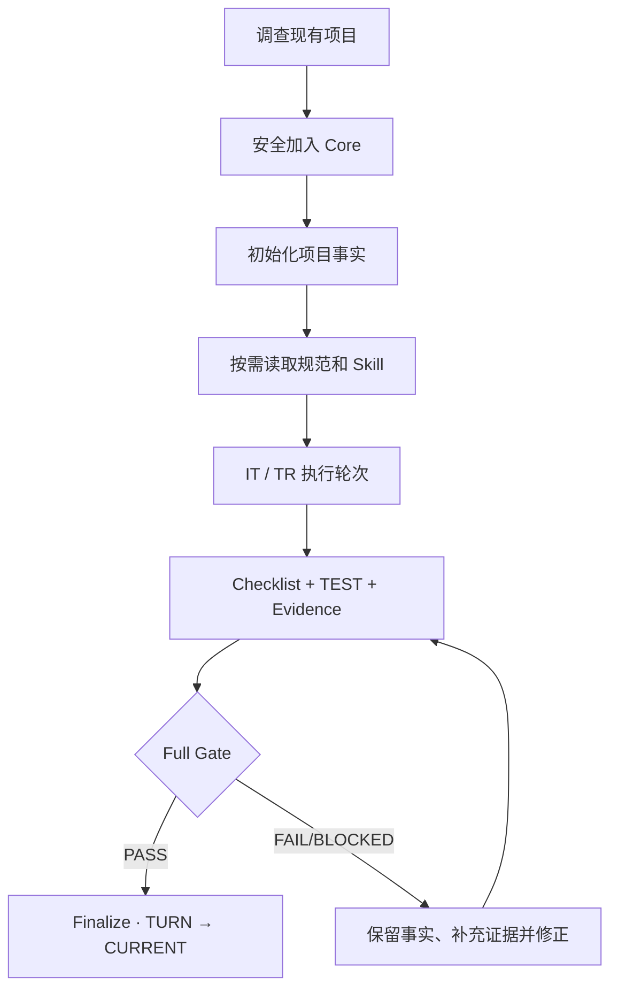

<!-- APCF-META {"schema":1,"visibility":"public"} -->
<div align="center">


图 1 APCF 标识、核心原则与系统概览

<h1>APCF · Agent Project Control Framework</h1>

<p><strong>让 AI Agent 在真实项目中遵守规则、持续执行、留下证据，并完成可复核交付</strong></p>

[English](README.en.md) · [快速开始](docs/QUICKSTART.md) · [框架架构](docs/ARCHITECTURE.md) · [首次接入提示词](APCF-START.md) · [最新 Release](https://github.com/AIALRA-0/APCF/releases/latest)

**Core v0.3.0** · **Rules R01–R31** · **Design D01–D16** · [CI workflow](.github/workflows/core-ci.yml)

</div>

## 1 为什么选择 APCF

让 Agent 写出代码只是起点；进入已有项目时，团队还需要核实以下问题：

- Agent 理解了什么
- 它使用了哪些规范
- 它改了哪些文件
- 怎样证明任务成功
- 失败后如何恢复

APCF 为这些问题提供可复用的项目控制层，帮助团队保留原有 Git、测试、IDE、构建与设计系统；它按三项原则管理执行：

- 单一事实来源
- 独立执行记录
- 证据驱动收口

## 2 APCF 提供什么

<div align="center">

表 1 APCF 的主要能力与默认行为

| 领域 | 核心能力 | 默认行为 |
|---|---|---|
| **Canonical Rules** | R01–R31 规范路由、状态、执行和交付约束 | 按阶段读取，不复制第二份正文 |
| **Writing Standard** | 术语、表述完整性、结构与专业解释 | 从当前规范入口解析，不固定过期词表 |
| **Style Standard** | 清晰、均衡、可读、密度可控的表达 | 尊重读者与项目场景 |
| **Design D01–D16** | UI/UX 原则、可选 Profile、设计差异 | **不自动改写网站 UI** |
| **Skills** | 可追踪来源、版本锁和按需加载 | 不安装无关技能缓存 |
| **IT / TR / TEST** | 独立目标、轮次、清单、验证和证据 | 每个真实项目从自身状态开始 |
| **Gate / Finalize** | 严格验收与 TURN → CURRENT 收口 | 不把未测项目伪装为通过 |

</div>

## 3 从取得安装器开始

仓库公开发布后，先从仓库根目录取得 `install-apcf.ps1`；首次使用时，可以在 PowerShell 中克隆公开仓库并运行脚本：

```powershell
# 从公开仓库取得本地安装脚本并运行固定版本 Core 安装器
git clone https://github.com/AIALRA-0/APCF.git APCF
pwsh -NoProfile -File .\APCF\install-apcf.ps1 -ProjectRoot "D:\Projects\my-project"
```

不使用 Git 时，也可以从 GitHub 仓库页面选择 `Code > Download ZIP`，解压源码包后从解压目录运行 `install-apcf.ps1`；安装脚本会从固定 Release tag `v0.3.0-closeout-v2` 下载正式部署包及 SHA-256 校验文件，验证通过后再调用 Core bootstrap；它不会通过 `Invoke-Expression` 执行远端脚本；目标路径、现有 Agent 入口或摘要校验发生冲突时，安装会停止，不覆盖原始业务源码；使用前请阅读[快速开始](docs/QUICKSTART.md)

**向 Agent 提出任务**

> 将 APCF 接入我当前的项目，依照 `APCF-START.md` 和 `.agent-project-control/interfaces/APCF_ONBOARDING.md` 连续完成项目调查、无损接入、规范和 Skill 初始化、首次 IT/TR、全生命周期 Pilot、验收与首轮报告；保留原网站 UI

安装后重新读取 `.agent-project-control/interfaces/APCF_ONBOARDING.md`，可恢复当前执行流程；检查项目 `PROJECT.md`、`ARCHITECTURE.md`、`DESIGN.md`、最新 IT/TR、CHECKLIST、TEST、门禁记录和 `CURRENT.md`，并根据实际证据判断 Pilot 是否通过

## 4 真实项目中的执行链

<div align="center">

Mermaid 是用文本描述流程图节点与连接的语法；下方保留原始图示源码，供读者查看执行顺序与判断分支



图 2 APCF 在既有项目中的执行与验收流程

</div>

## 5 文件结构与系统架构

```text
AGENTS.md
CURRENT.md
APCF-START.md
.agent-project-control/
  framework.yaml        # Core 状态与入口
  rules/                # R01–R31
  routing.toml          # 任务阶段与能力路由
  standards/            # Writing / Style 正文
  interfaces/           # 规范入口和首次接入合同
  design/               # D01–D16 / Profile / Lock
  skills/               # Skill 版本与来源
  scripts/              # 检查 / 验收 / 收口
  iterations/           # 本项目独立 IT/TR
  regressions/          # 本项目长期失效记录
  runtime/              # 空脚手架；不附带浏览器和依赖
```

完整说明见[架构与文件](docs/ARCHITECTURE.md)；上方树状图概括当前 Core 的关键目录，不替代由当前发行清单生成的真实文件树

<details>
<summary>展开查看 Core 文件与规范结构图</summary>

<div align="center">


图 3 APCF Core 文件、规范、执行与验收关系

</div>

</details>

## 6 对既有项目的边界

- **原业务代码、测试、构建与部署仍由原项目管理**，APCF 不重排目录，也不强制更换语言或框架
- **APCF 不自动改写网站 UI**；Design Profile 与 Atlas 属于可选组件，使用设计规则也不代表允许 Agent 自动重构界面
- **失败必须明确记录**，缺少证据、候选发生变化、检查未通过或外部受阻时，不能宣称全部 PASS
- **公开发行不携带源开发历史**，Core 由干净分发生成，不包含旧 TR、私人材料、Chromium、依赖或 Git AI 记录

## 7 文档、授权与使用边界

[接入安全合同](docs/APCF_ONBOARDING.md) · [Core / Add-on / Git 历史策略](docs/RELEASE_POLICY.md) · [安装器](install-apcf.ps1) · [架构](docs/ARCHITECTURE.md)

当前候选未附 `LICENSE` 文件；Public 仓库状态本身不构成开源授权，也不自动授予复制、修改或再分发权；外部业务项目的 Pilot、生产部署与账户操作仍需项目自己的授权与验收

---

[更新记录](CHANGELOG.md) · [贡献指南](CONTRIBUTING.md) · [安全披露](SECURITY.md)
