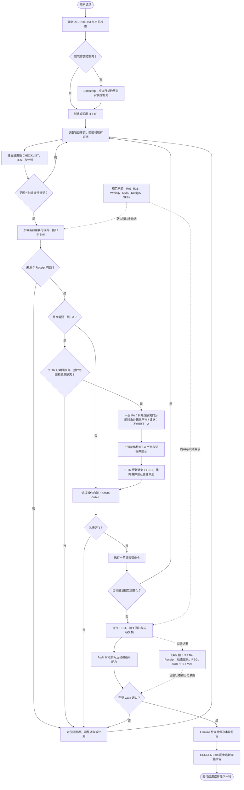

<!-- APCF-META {"schema":1,"visibility":"public"} -->
<div align="center">
<h1>APCF 智能体项目控制框架（Agent Project Control Framework）</h1>
<p>面向 Codex 的项目规则、执行范围、验收门禁与可复核交付记录</p>
<p>框架数据模式 v0.3.0 · Writing、Style 与 Design 规则 v0.1</p>
<p><a href="README.en.md">English</a></p>
<p><a href="#workflow-map">工作流总览</a></p>
</div>

## 1 工作流总览

APCF 为长任务提供一条可复核的执行路径，覆盖规则确认、范围调查、实施验收和结果收口；任务步骤和失败回路见下图，成功后由同一份报告更新 `CURRENT.md`

<a id="workflow-map"></a>

<div align="center">



<p align="center"><em>图 1.1-1 任务从范围调查到可追溯交付的主路径；失败分支回到调查</em></p>

</div>

需要并行时，主 TR 先确认当前规则来源、任务与写入授权范围、资源隔离和回收条件，再建立最多一层 PA；每个 PA 只处理隔离的分配对象并保存自身产物与证据，不能创建子 PA

主智能体检查 PA 交付、整合结果，更新主 TR 计划与 TEST，并按整合后的候选重新路由和验证；Receipt 证明适用来源已加载，不代替用户对外部操作的授权

首次安装时，`bootstrap.py` 先检查目标，再把控制壳安装到新目录或没有冲突标记的既有项目；已有 IT、TR、材料和运行记录不会作为模板历史带入

安装完成后，智能体（Agent）按 `AGENTS.md` 创建或沿用迭代与执行轮次，并只加载当前任务触发的规则、接口与技能（Skill）

计划要把目标文件、调查依据和当前测试关联起来

执行前的操作门禁（Action Gate）检查当前计划和证据，再放行一条操作命令；每次命令只运行一次，不会自行循环修复

完成后，测试记录实际命令、退出码和输出，内容复核记录观察位置、规范摘要与结论

事后路由审计（Post-route Audit）检查计划是否覆盖真实活动，完整验收门禁（Full Gate）再检查当前候选、检查记录和内容复核

失败时，智能体根据具体发现重新调查并制定修复；门禁不会替智能体猜测或重试

## 2 项目用途与边界

本模板适合需要 Codex 长期维护的代码项目，重点是让用户请求、项目规则、实际改动、测试和交付记录相互对应

- 保留原项目的源码、测试、配置和工具链结构，只增加 APCF 控制壳
- 将规范来源、项目事实、当前执行记录和临时运行对象分开维护
- 通过真实命令、当前文件摘要和证据记录支持验收
- 让用户授权决定外部账号、远端仓库、部署和发布操作

APCF 不代替项目原生测试、专业判断、用户授权或真实环境验收；模板不预设业务目标、架构和设计采用事实

## 3 文件与事实来源

每个事实只有一个维护位置；README 只介绍入口，不复制规范正文

- `AGENTS.md` 是智能体执行入口，负责初始化、规范路由和最终收口要求
- `.agent-project-control/framework.yaml` 声明框架数据模式版本 `v0.3.0`
- `.agent-project-control/rules/INDEX.md` 路由 R01–R31；规则正文位于 `.agent-project-control/rules/`
- `.agent-project-control/PROJECT.md` 保存项目目标、用户和范围
- `.agent-project-control/ARCHITECTURE.md` 保存系统边界、依赖、数据与运行事实
- `.agent-project-control/DESIGN.md` 保存项目设计采用状态、事实来源和差异
- `.agent-project-control/interfaces/` 路由 Writing `v0.1` 与 Style `v0.1`；版本锁位于 `.agent-project-control/standards/LOCK.yaml`
- `.agent-project-control/design/` 保存共享 D01–D16 规则 `v0.1`、版本锁和可选 Profile
- `.agent-project-control/skills/SKILLS.lock.yaml` 保存 Skill 来源、版本和必需状态
- `CURRENT.md` 指向当前状态和最近完整用户报告
- IT 是承载稳定目标的本地对象标识；TR 是一次用户请求的独立记录，关联清单、测试与证据
- 每个 TR 的 `CHECKLIST.md`、`TEST.md` 和 `evidence/` 记录范围、验收条件和观察结果
- `.agent-project-control/regressions/`、`decisions/`、`runbooks/` 与 `materials/` 分别维护长期回归、决策、操作手册和用户资料
- `.agent-project-control/runtime/` 只放 Agent 临时运行、缓存、测试副本和分发候选
- `.agent-project-control/scripts/` 提供路由、验收、同步、安装和生成工具

`PROJECT.md`、`ARCHITECTURE.md` 与 `DESIGN.md` 在新项目中保持未知或未采用状态，直到 Agent 根据项目事实补充；可选的 `tool-workbench-2.3.1` Profile 设置为不自动采用

## 4 首次运行：两个合成示例

示例需要 Python 3.11 或更新版本以及 Git；它们在 `.agent-project-control/runtime/testbed/` 下创建独立项目、初始化本地 Git 仓库并保存演示记录，不会推送、修改当前源仓历史或自动采用设计样板配置（Profile）

从仓库根目录运行两个不同的新路径：

```powershell
python -B examples/run_demo.py --project .agent-project-control/runtime/testbed/apcf-demo-success --scenario success
python -B examples/run_demo.py --project .agent-project-control/runtime/testbed/apcf-demo-repair --scenario repair
```

- `success` 创建最小 Python 模块，用两条真实断言验证结果，再运行 Audit、完整 Gate、Finalize 和状态一致性检查
- `repair` 先制造一处可编辑正文格式失败，确认 Gate 拒绝且候选未变，再局部修复正文并检查受保护代码块保持不变，随后完成同一收口路径

每个目标路径必须是新目录或空目录；演示不会清理已有内容

重复运行时请换一个新目录名

示例结果只证明这些固定合成输入和边界，不代表任何真实业务项目已经通过验收

## 5 实际项目的执行路径

Agent 会按当前 `CURRENT.md` 和用户请求决定沿用哪个 IT，或是否形成新的稳定目标；普通任务通常在当前 ACTIVE IT 下创建新的 TR

计划通过 `routing_activity.py plan` 关联实际调查证据、目标文件和测试 ID：

```powershell
python -B .agent-project-control/scripts/routing_activity.py plan --turn-dir PATH_TO_TR --target src/example.py --investigation evidence/investigation.md --regression-test TEST-001
```

智能体为实际目标路径建立当前 Receipt，并读取路由返回的规范来源；通用项目级 Receipt 不能替代当前目标的路由覆盖

```powershell
python -B .agent-project-control/scripts/route_context.py --phase scope --phase verification --phase tools --phase finalization --target src/example.py --turn-dir PATH_TO_TR
```

路由后，智能体检查目标文件和已有证据，再写入对象专属的语义复核记录

智能体调用 `record_semantic_review()` 生成记录，依据包含当前目标结论与已存在证据摘要；用户不需要填写空白 `--semantic-reviewed` 标记

Action Gate 只在当前路由、计划和证据有效时执行一次命令：

```powershell
python -B .agent-project-control/scripts/gate_enforce.py --entrypoint action --turn-dir PATH_TO_TR --target src/example.py --run python -B -m pytest
```

此示例要求项目环境已安装 pytest 和项目原生依赖；默认 pytest 摘要包含 `passed`

`routing_activity.py check` 会实际运行测试命令并保存退出码、必要输出和当前候选摘要；必需文本应按实际输出选择，手工写入 `PASS` 不能替代这项观察：

```powershell
python -B .agent-project-control/scripts/routing_activity.py check --turn-dir PATH_TO_TR --test-id TEST-001 --target src/example.py --expected-exit 0 --required-output passed --command python -B -m pytest
```

若目标属于 Writing、Style、Design 或 README 能力，智能体还要使用 `record_content_review()` 保存具体观察位置、依据文件摘要和当前规范摘要；完整验收要求当前检查记录与内容复核都有效

复杂首次使用路径以两个合成示例为可执行参考，命令的完整参数以对应脚本 `--help` 为准

## 6 规范、Skills 与设计采用

- 人类可读内容通过 `WRITING_STANDARD.md` 解析 Writing v0.1，并与 Style v0.1 一起执行；正文只维护在 `.agent-project-control/standards/`
- README 的领域标准来自完整锁定的 `AIALRA-0/github-readme-standardizer` Skill；required Skill 的同步需要对锁定来源具有读取权限，并校验提交与 `SKILL.md` 摘要
- `github-safe-publish` 是本地固定摘要的可选 Skill，不随干净分发携带；缺失时同步检查报告 `OPTIONAL_UNAVAILABLE`，显式触发该能力仍会失败关闭（Fail Closed）
- Design v0.1 是共享 D01–D16 规则；`tool-workbench-2.3.1` 是可选 Profile，`auto_adopt: false`，需要项目事实和明确采用状态才能用于项目参数
- Mermaid 是用文本描述并渲染流程图的工具；本页按当前 README Skill 将图表和题注放在同一居中容器，中英文保持相同拓扑，实际渲染结果需要独立核验

规范升级会改变来源摘要；旧 Receipt 随后不能替代对新规范的读取和复核

## 7 安装与干净分发

创建空项目或向没有 APCF 标记的既有代码目录增加控制壳时，从模板仓库根目录运行：

```powershell
python -B .agent-project-control/scripts/bootstrap.py ../my-project
```

安装保留既有源码和配置，只增加 `AGENTS.md`、`CURRENT.md`、`.agent-project-control/` 与空的 `.codex` 元数据目录；目标父目录必须已存在

目标已有 `AGENTS.md`、`CURRENT.md`、`.agent-project-control/` 或 `.aialra/` 时，安装会在写入前拒绝，不会删除或覆盖这些对象

应改用新目录，或在现有 APCF 安装上按其规则继续工作

核心分发模式（Core）面向其他项目的框架接入；它保留通用规则、共享设计基线，以及写作、风格和技能合同，并排除 `design/components/*` 下的可选界面组件

可选附加组件（Add-on）是按项目需要单独安装的能力；Atlas 工作台属于这一类，应独立提供，不是 Core 的默认依赖，项目设计采用状态仍从 `UNRESOLVED` 开始

生成不带可选组件、源仓 Git 历史、IT/TR、MAT、runtime 内容和 Skill 缓存的 Core 候选：

```powershell
# 生成独立 Core 候选，保留源仓历史和当前工作树
python -B .agent-project-control/scripts/prepare_distribution.py --profile core
```

脚本输出候选目录；候选保留规范、接口、锁、脚本、公开说明和 `examples/`，并重新生成目录树

本修订在不传 `--profile` 和显式 `core` 时都使用同一份明确的核心成员清单；可选组件独立分发，不再通过默认递归复制混入 Core

接入通用 Core 时，先生成或解压 Core 候选，再从该 Core 目录运行上方的 `bootstrap.py` 命令；安装使用明确成员并生成目标项目自己的初始事实，不继承开发源的项目说明或可选 UI

它不会创建 ZIP、设置远端或发布；可选 `--manifest PATH` 会在候选以外生成私有文件摘要清单，清单路径和内容不应加入公开包

技能同步检查为：

```powershell
python -B .agent-project-control/scripts/sync_skills.py --check
```

缺少可选缓存不会让此项检查失败；必需 Skill 缺失或摘要、提交不符仍会失败

同步 required README Skill 需要网络和对应来源权限，脚本会按锁验证；分发不包含 `.git` 或 `.codex/skills` 缓存

**运行候选发布检查前：** 从当前模板源仓根目录把以下变量设置为实际对象路径

- `$turn`：当前真实源 TR
- `$candidate`：包含发布候选的独立本地 Git 仓库
- `$manifest`：候选仓库外的私有路径、字节数和 SHA-256 清单
- `$zip`：实际发布 ZIP

三个候选参数必须同时提供；检查会验证源 TR 的发布 Full Gate 和状态，并按清单逐项核对独立 Git index 与 ZIP 实际成员

Gitleaks 必须能从 `PATH` 调用；缺失或扫描未能完成时，检查会 fail closed

只有先按锁定来源安装可选 `github-safe-publish`，才显式触发 `github-publish`；干净分发不带该技能缓存，缺失时该能力会 fail closed

```powershell
python -B .agent-project-control/scripts/publish_guard.py --turn-dir "$turn" --candidate-repo "$candidate" --manifest "$manifest" --candidate-zip "$zip"
```

该命令只检查已提供对象，不自动授予外部操作授权，不会提交或推送，也不能阻止绕过它直接使用裸 `git push`

## 8 验证与失败修复

门禁结论来自当前候选和证据，不等同于用户目标整体正确

测试、回归、语义复核和内容复核各自覆盖不同问题，不能互相替代

- `REPAIR_REQUIRED` 表示存在可修复发现；Agent 应先读 `REPAIR_SET`，定位根因并制定可验证修复
- `CHANGED` 描述连续两次检查之间的失败集合变化，不代表通过；检查新增发现和剩余失败后再继续
- `STALLED` 表示候选或失败集合没有进展，`CYCLE` 表示本轮修复中旧失败集合重现；两者会导致 `NO_PROGRESS`，不应重复执行相同动作
- `BLOCKED` 表示存在当前无法安全解决的发现；Agent 说明具体缺少的证据、能力或用户决定，再选择可继续的独立工作

每次失败都保留门禁记录并回到调查和计划；系统不自动无限重试，也不允许通过手工填写 `PASS` 绕过门禁

人工审核需要说明具体对象和观察结果，机器检查通过也不证明所有语义要求均已满足

## 9 脱敏与运行数据

分发按可见性元数据、对象生命周期和唯一事实来源分类

公开标记只说明对象可以进入候选，不证明内容没有秘密；候选还要扫描个人绝对路径、账号、邮箱、凭据和带凭据连接信息

- 保留规则、正式规范、版本摘要、相对路径和清晰标注的合成示例
- 排除源仓 `.git`、开发 IT/TR/MAT、运行证据、缓存和机器专属状态
- 不改写源仓历史来制造干净候选；源文件摘要在生成前后保持不变
- 对疑似身份或凭据保留复核状态，不因正则未命中就宣称绝不泄露

开发记录和机器特有路径只留在私有执行证据，不进入公开模板报告

## 10 入口与已知边界

- [Codex 执行提示](CODEX_PROMPT.md)：项目接入后交给 Codex 的起始上下文
- [部署合同](CODEX_DEPLOY.md)：项目创建、现有项目接入和远端权限边界
- [模板规格](TEMPLATE_SPEC.md)：公开内容、控制壳与项目事实的职责
- [Pilot 测试计划](PILOT_TEST_PLAN.md)：新副本中的安装和验收步骤
- [验证说明](VALIDATION.md)：模板能力、验证范围和明确未覆盖的环境
- [Framework 入口](AGENTS.md)：规则加载、任务初始化和收口路由

框架中 `tomllib` 依赖 Python 3.11 或更新版本；其他操作系统和 GitHub 页面最终渲染仍需在实际目标环境复核

## 11 上一维护版本 core-repair-r1

首次和后续请求从 [APCF-START.md](APCF-START.md) 恢复，实际次序由 [项目接入入口](.agent-project-control/interfaces/APCF_ONBOARDING.md) 协调；新验收使用自然正文，正文定位、术语依据和要点覆盖共同进入内容核对

当前请求身份与计划写入仅约束实际调用这些入口的动作，不能证明宿主已拦截全部工具或聊天；待发送文本和实际捕获文本分开核对，不能用文件检查冒充消息已送达

维护修订保留 schema 0.3.0、旧历史兼容和 Writing／Style／共享设计正文；[修订身份](.agent-project-control/REPAIR-REVISION.md) 与 [可见设计参考](.agent-project-control/design/REFERENCE-MAP.md) 分别说明当前候选和旧 Profile 的边界

## 12 本阶段交付与轻量监督

本阶段发行候选名为 `v0.3.1`，框架数据模式继续兼容 `0.3.0`；它以实测 r1 候选为来源，不把旧公开源码作为覆盖基线；核心验收版本与外部 Codex 版本必须分别记录

每轮通过 `scripts/supervisor.py` 在当前项目核对 CURRENT 和真实来源、输出阶段规范、检查计划、复用验收及正式收口；首次接入和恢复入口见 [执行监督接口](.agent-project-control/interfaces/EXECUTION_SUPERVISION.md) 与 [接入说明](APCF-START.md)

监督回执只说明实际观察过的动作；读取规范不证明模型理解，作者复核不等于独立评审，受控文件写入不等于全部终端被拦截；桌面自动触发与真实输出只有实际宿主运行后才能标为验证，不得用函数测试代替

旧 `tool-workbench-2.3.1` 仍是锁定历史 Profile，不是最新 Atlas；公开发行另提供可直接打开的 `examples/design-atlas/index.html`，最小 Core 不带演示应用，也不默认改写原项目的 UI

完整 Pilot 用于核心发行与重要修订；普通任务按现行规则执行适用检查，不把框架全部自检变成每次修改的固定开销；执行时间与宿主未覆盖部分都需要在本轮报告中据实说明
