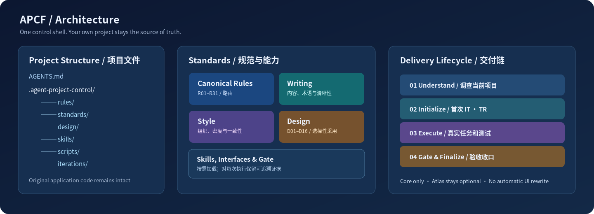
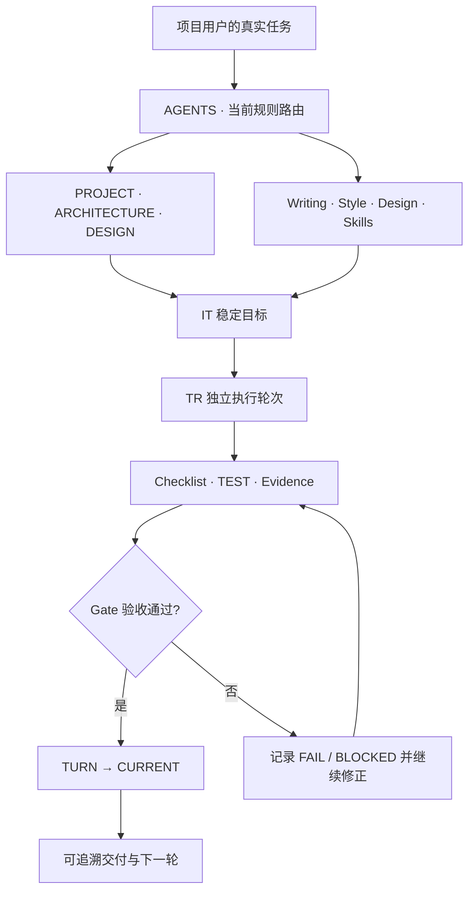

<!-- APCF-META {"schema":1,"visibility":"public"} -->

# APCF 结构与职责

<div align="center">



图 1 APCF Core 文件、规范、执行与验收关系

</div>

```text
APCF/
├── AGENTS.md                       # 最小 Agent 规则路由入口
├── CURRENT.md                      # 当前状态，由正式 TURN 生成
├── APCF-START.md                   # 首次接入的简短触发提示
├── .agent-project-control/
│   ├── framework.yaml              # Core 配置
│   ├── rules/                      # R01–R31 唯一 Canonical 正文及索引
│   ├── routing.toml                # 阶段与能力路由
│   ├── interfaces/                 # Writing/Style/首次接入的入口
│   ├── standards/                  # Writing 与 Style 的规范权威
│   ├── design/                     # D01–D16、可选 Profile 与基线锁
│   ├── skills/                     # Skills Lock 与按需安装合同
│   ├── scripts/                    # lint、Pilot、Gate、Finalize 等
│   ├── iterations/                 # 下游安装后从自己项目的 IT/TR 开始
│   ├── regressions/                # 下游自己的 REG
│   ├── materials/                  # 下游自己的材料索引
│   └── runtime/                    # 下游的空运行脚手架（不预装依赖）
└── .codex/                          # Agent/Skill 集成入口（如当前 Core 提供）
```

树状图概括当前 Core 已验证的关键目录，并非替代实时 `generated/TREE.md`；发布工具会在最终包内重新生成真实文件清单

Mermaid 是用文本描述图形节点与连线的语法；以下保留原始流程图源码



**核心与可选组件边界**：Core 只管理规范、项目状态和验收；Design Atlas 属于独立 Add-on，默认不安装、不改变前端主题；原项目代码与其原生构建工具仍是自己领域的权威
